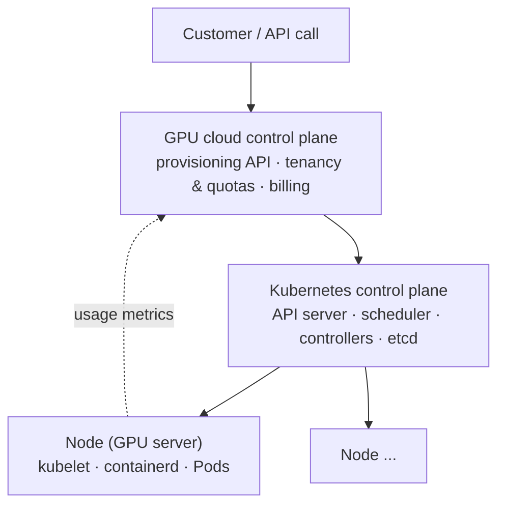

# Control plane

The **control plane** is the part of a system that *decides and manages*; the **data plane** is the part that *does the actual work*. In a restaurant, the manager taking reservations, assigning tables, and keeping the books is the control plane; the kitchen cooking food is the data plane. The term is used at two levels in this wiki, and real systems use both. (general knowledge)

## Details

### Level 1: the Kubernetes control plane

- In [[kubernetes]], the control plane manages every [[kubernetes-node|Node]], and it automatically [[kubernetes-scheduling|schedules]] [[kubernetes-pod|Pods]] across Nodes based on each Node's available resources. (src: [[2026-11-22-k8s-viewing-pods-and-nodes]])
- On each Node, the [[kubelet]] is the control plane's point of contact: it communicates between the control plane and the Node and manages that Node's Pods. (src: [[2026-11-22-k8s-viewing-pods-and-nodes]])
- Its parts (general knowledge; verified: [Kubernetes Components](https://kubernetes.io/docs/concepts/overview/components/)):
  - **API server (kube-apiserver):** the front door. Every request, from [[kubectl]], the kubelets, or the other components, goes through its HTTP API. The tutorial's proxy URL `/api/v1/namespaces/default/pods/...` is a path on this API (path: src: [[2026-11-22-k8s-viewing-pods-and-nodes]]).
  - **etcd:** a consistent, highly available key-value store holding all API data, i.e. every object's desired state (spec) and last reported state (status).
  - **Scheduler (kube-scheduler):** picks a Node for each new Pod ([[kubernetes-scheduling]]).
  - **Controller manager (kube-controller-manager):** runs controllers (e.g. for [[kubernetes-deployment|Deployments]], [[kubernetes-replicaset|ReplicaSets]], and Node health) that keep comparing desired state to actual state and fixing the difference. This loop is called **reconciliation**.
  - **cloud-controller-manager** (optional): integrates with a cloud provider's APIs, e.g. for load balancers and VM-backed Nodes.
- Reconciliation in action: the tutorial runs `kubectl scale deployments/kubernetes-bootcamp --replicas=4`; `kubectl get deployments` then shows 4 instances available and `kubectl get pods -o wide` shows 4 Pods ([[kubernetes-scaling]]). (src: [[2026-11-23-k8s-running-multiple-instances-of-your-app]]) Under the hood, `scale` only records a new desired count in the Deployment's `.spec.replicas`; the Deployment controller passes it to the ReplicaSet, whose controller creates Pods until the running count matches. (general knowledge)
- The Nodes, kubelets, and containers doing the work are often called the data plane; Kubernetes' own docs call these the worker Nodes and node components. (general knowledge)

### Level 2: a GPU cloud's control plane

- A GPU cloud's control plane is the software that turns hardware into a product: APIs to create clusters, instances, or endpoints; accounts, tenants, and quotas; the lifecycle of machines and workloads; and metering usage into bills. These are this wiki's four domains. The data plane is the GPUs, servers, network, and the customer workloads running on them. (general knowledge)
- It usually *contains* Kubernetes rather than replacing it: the cloud's API receives "create an 8-GPU endpoint for tenant A", checks A's quota, then creates Kubernetes objects (namespaces, Deployments, Pods) on GPU Nodes, and meters what runs. (general knowledge)
- The serving responsibilities split the same way: per-replica work inside the [[inference-frameworks|inference framework]] vs cross-replica, cross-tenant work in the platform ([[inference-serving]]). (general knowledge)

## Related

- [[kubernetes]]: the most common lower-level control plane in GPU clouds.
- [[kubelet]]: the control plane's agent on each Node.
- [[kubernetes-scheduling]]: one of its core jobs.
- [[kubernetes-scaling]]: reconciliation driven by a changed replica count.
- [[inference-serving]]: serving responsibilities, mapped to the four domains.
- [[software-development-lifecycle]]: the control plane is software too, planned, built, tested, and shipped through an SDLC.
- [[deployment-gates]]: gated, staged rollouts of control-plane changes.
- [[overview]]: where each domain stands in this wiki.
