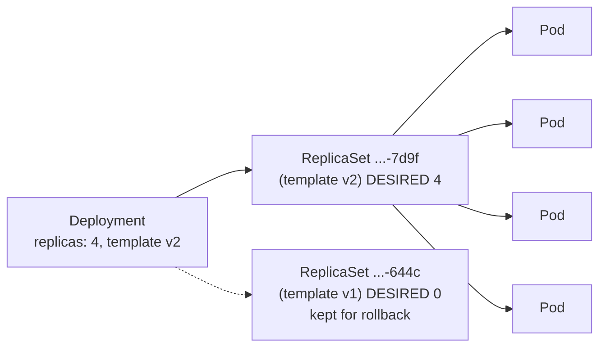

# ReplicaSet (Kubernetes)

A **ReplicaSet** is the [[kubernetes]] object that keeps a fixed number of identical [[kubernetes-pod|Pods]] running. It holds two things: a desired count, and a Pod template describing what to create. A controller then repeatedly counts the matching Pods and creates or deletes Pods until the count is right. You rarely create one directly. A [[kubernetes-deployment|Deployment]] creates and manages ReplicaSets for you. Analogy: if the Deployment is the manager who decides "4 cashiers on the current uniform", the ReplicaSet is the shift supervisor who counts heads and calls people in or sends them home. (src: [[2026-11-22-k8s-using-a-service-to-expose-your-app]], [[2026-11-23-k8s-running-multiple-instances-of-your-app]]; analogy and "rarely create directly": general knowledge)

## Details

- When Pods are lost (e.g. a [[kubernetes-node|Node]] dies), the ReplicaSet drives the cluster back to the desired state by creating new Pods. (src: [[2026-11-22-k8s-using-a-service-to-expose-your-app]])
- `kubectl get rs` shows **DESIRED**, the replica count set on the Deployment (the desired state), and **CURRENT**, how many replicas are running. (src: [[2026-11-23-k8s-running-multiple-instances-of-your-app]]) It also shows a READY column. (general knowledge)
- The tutorial says its name is `[DEPLOYMENT-NAME]-[RANDOM-STRING]`, with the string generated using the **pod-template-hash** as a seed. (src: [[2026-11-23-k8s-running-multiple-instances-of-your-app]]) More precisely, the suffix *is* the `pod-template-hash` value: a hash of the Pod template, not a random string, so changing the template (e.g. a new image) produces a new ReplicaSet with a different suffix. See Contradictions. (general knowledge; verified: [Deployments](https://kubernetes.io/docs/concepts/workloads/controllers/deployment/#creating-a-deployment))
- **Reading a Pod name:** `kubernetes-bootcamp-644c5687f4-wp67j` is Deployment name + ReplicaSet hash + a per-Pod random suffix. (Pod name: src: [[2026-11-23-k8s-running-multiple-instances-of-your-app]]; breakdown: general knowledge)
- Scaling a Deployment ([[kubernetes-scaling]]) changes its ReplicaSet's desired count. The ReplicaSet does the actual creating and terminating. (src for scaling via replicas: [[2026-11-23-k8s-running-multiple-instances-of-your-app]]; division of labour: general knowledge)
- How it finds "its" Pods (general knowledge): through a [[kubernetes-labels-and-selectors|label selector]] that includes the `pod-template-hash` label, plus an owner reference on each Pod pointing back to the ReplicaSet.

### Deployment → ReplicaSet → Pods

General knowledge.

- One ReplicaSet exists per Pod-template version. A [[kubernetes-rolling-update|rolling update]] scales the new ReplicaSet up and the old one down step by step. Old ReplicaSets are kept at 0 replicas (10 by default) so `kubectl rollout undo` can switch back. The tutorial shows the visible half of this: `set image` starts the update, new Pods appear while old ones terminate, and `rollout undo` returns to the previous version (src: [[2026-11-27-k8s-performing-a-rolling-update]]).
- The Deployment owns rollout strategy and history. The ReplicaSet only knows "N copies of this template". That is why you scale and update the Deployment, never its ReplicaSet: the Deployment would overwrite a manual change to the ReplicaSet.

## Related

- [[kubernetes-deployment]]: creates and owns ReplicaSets; the object you actually edit.
- [[kubernetes-scaling]]: changes the desired count a ReplicaSet enforces.
- [[kubernetes-rolling-update]]: moves Pods from the old template's ReplicaSet to the new one.
- [[kubernetes-pod]]: what a ReplicaSet creates and replaces.
- [[kubernetes-labels-and-selectors]]: how a ReplicaSet identifies its Pods.
- [[control-plane]]: its controller is one of the reconciliation loops in the controller manager.

## Contradictions

- **Is the ReplicaSet suffix random?** The tutorial calls it a "random string ... [that] uses the pod-template-hash as a seed" (src: [[2026-11-23-k8s-running-multiple-instances-of-your-app]]). The Deployments concept doc says the name is `[DEPLOYMENT-NAME]-[HASH]`, and the same value appears as the `pod-template-hash` label on the ReplicaSet and its Pods; it is deterministic for a given template. (general knowledge; verified: [Deployments](https://kubernetes.io/docs/concepts/workloads/controllers/deployment/#pod-template-hash-label))

## Open questions

- Which Pods does a ReplicaSet delete first on scale-down, and what does the `controller.kubernetes.io/pod-deletion-cost` annotation change?
