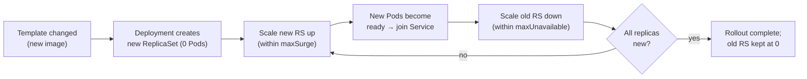

# Rolling update (Kubernetes)

A **rolling update** is how a [[kubernetes-deployment|Deployment]] moves its app to a new version without downtime. It replaces the old [[kubernetes-pod|Pods]] with new ones a few at a time. New Pods start on [[kubernetes-node|Nodes]] that have free resources, old ones are removed as new ones come up, and the [[kubernetes-service|Service]] sends traffic only to Pods that can handle it. Clients keep using the same address the whole time. (src: [[2026-11-27-k8s-performing-a-rolling-update]]) Analogy: changing the light bulbs in a hall one at a time, so the room is never dark. (general knowledge)

![[raw/assets/k8s-rollingupdates-2.svg]]
Mid-update: one Pod has been replaced by the updated app on a new IP (10.0.0.6) while the old one fades out. The other three Pods still run the old version, and Service A (10.3.250.236) covers both versions. (src: [[2026-11-27-k8s-performing-a-rolling-update]])

![[raw/assets/k8s-rollingupdates-4.svg]]
Finished: all four Pods run the new version, each on a new IP, and the Service IP is unchanged. (src: [[2026-11-27-k8s-performing-a-rolling-update]])

## Details

### What triggers one

- Changing the Deployment's Pod template triggers a rollout. The usual change is a new [[container]] image, e.g. `kubectl set image deployments/<name> <container>=<image>:<tag>`. (src: [[2026-11-27-k8s-performing-a-rolling-update]])
- Only a template change creates a new **revision**, for example a new image or new Pod labels. Scaling does not; it changes the replica count in place ([[kubernetes-scaling]]). (general knowledge; verified: [Deployments, rolling back](https://kubernetes.io/docs/concepts/workloads/controllers/deployment/#rolling-back-a-deployment))
- `.spec.strategy.type` is `RollingUpdate` by default. The other value, `Recreate`, stops every old Pod before any new one starts, which means downtime. (general knowledge; verified: [Deployments, strategy](https://kubernetes.io/docs/concepts/workloads/controllers/deployment/#strategy))

### How it proceeds: two ReplicaSets trade places

General knowledge; verified: [Deployments, updating a Deployment](https://kubernetes.io/docs/concepts/workloads/controllers/deployment/#updating-a-deployment).

- Each Pod-template version has its own [[kubernetes-replicaset|ReplicaSet]]. The rollout scales the new one up and the old one down, step by step, until every replica runs the new template.
- A new Pod counts as **available** once it is ready and has stayed ready for `minReadySeconds` (default 0). Readiness comes from the Pod's readiness probe. Without one, a Pod is ready as soon as its containers start ([[kubernetes-service]]).

### Pace: maxSurge and maxUnavailable

- Two limits control the pace. **maxUnavailable** is how many Pods may be unavailable during the update. **maxSurge** is how many Pods may exist beyond the desired count. Each can be a number or a percentage of Pods. (src: [[2026-11-27-k8s-performing-a-rolling-update]])
- Both default to **25%**. Surge rounds up and unavailable rounds down, and they cannot both be 0. (general knowledge; verified: [Deployments, max surge](https://kubernetes.io/docs/concepts/workloads/controllers/deployment/#max-surge)) The tutorial gives the default as one of each; see Contradictions.

What the 25% defaults mean at different sizes (worked from the documented rule):

| Replicas | maxSurge (↑) | maxUnavailable (↓) | Most Pods at once | Fewest available |
| --- | --- | --- | --- | --- |
| 1 | 1 | 0 | 2 | 1 |
| 2 | 1 | 0 | 3 | 2 |
| 4 | 1 | 1 | 5 | 3 |
| 10 | 3 | 2 | 13 | 8 |

- With few replicas the defaults behave as "start a new Pod before stopping an old one". That is why even one replica can update without downtime. More replicas make the update safer, because capacity never drops to a single Pod. (general knowledge)
- Terminating Pods don't count as available, but they still use resources until their grace period ends. While a rollout is running, total usage can briefly go above replicas + maxSurge. (general knowledge; verified: [Deployments, updating](https://kubernetes.io/docs/concepts/workloads/controllers/deployment/#updating-a-deployment))

### Zero downtime depends on the Service

- During the update, the Service routes traffic only to Pods that are serving requests, so users keep reaching the app. (src: [[2026-11-27-k8s-performing-a-rolling-update]])
- The Pods' IPs all change, but the Service IP does not (diagrams above). (src: [[2026-11-27-k8s-performing-a-rolling-update]])
- Old and new versions serve traffic **at the same time** during the rollout. Two clients, or two requests from one client, can get different versions. (general knowledge)

### Watching a rollout

- `kubectl rollout status deployments/<name>` shows a rollout's progress and waits for it to finish. `kubectl get pods` shows new Pods arriving and old ones terminating. In `kubectl describe pods`, the `Image` field shows which version a Pod runs. (src: [[2026-11-27-k8s-performing-a-rolling-update]])
- A Deployment reports one of three states: **Progressing** (a new ReplicaSet is being scaled up or the old one down), **Complete** (every replica is updated and available and no old replicas remain), or **Failed**. (general knowledge; verified: [Deployments, Deployment status](https://kubernetes.io/docs/concepts/workloads/controllers/deployment/#deployment-status))

### When a rollout goes wrong

- The tutorial's example: updating to a tag that doesn't exist (`v10`) leaves some new Pods in **`ImagePullBackOff`**, and `get deployments` shows fewer available Pods than desired. `kubectl describe pods --show-events=true` shows in `Events` that the image wasn't found in the repository. (src: [[2026-11-27-k8s-performing-a-rolling-update]])
- `ImagePullBackOff` means the [[kubelet]] could not pull the image (wrong name or tag, or a missing credential for a private registry). It keeps retrying, waiting longer each time up to a 300 s cap. (general knowledge; verified: [Images, ImagePullBackOff](https://kubernetes.io/docs/concepts/containers/images/#imagepullbackoff))
- **The rollout stalls rather than taking the app down.** The controller stops scaling up the new ReplicaSet, and maxUnavailable keeps enough old Pods serving. In the tutorial's case, assuming 4 replicas at the 25% defaults: 2 new Pods are stuck and 3 old ones keep serving. (stall: general knowledge; verified: [Deployments, rolling back](https://kubernetes.io/docs/concepts/workloads/controllers/deployment/#rolling-back-a-deployment); 2-and-3 split: worked from the documented rule)
- After `progressDeadlineSeconds` (default **600**) with no progress, the Deployment gets the condition `Progressing=False` with reason `ProgressDeadlineExceeded`. Kubernetes does **nothing else**. It does not roll back on its own; that is left to a person or "higher level orchestrators". Typical causes are image-pull errors, insufficient quota, failing readiness probes, missing permissions, and app misconfiguration. (general knowledge; verified: [Deployments, failed Deployment](https://kubernetes.io/docs/concepts/workloads/controllers/deployment/#failed-deployment))

### Revisions and rollback

- Updates are versioned, and you can revert to any earlier known state of a Deployment. `kubectl rollout undo deployments/<name>` returns to the previous one, which in the tutorial is `v2`. (src: [[2026-11-27-k8s-performing-a-rolling-update]])
- Each revision is an old ReplicaSet kept at 0 replicas. `kubectl rollout history deployment/<name>` lists them, `--to-revision=N` picks a specific one, and `revisionHistoryLimit` (default 10) caps how many are kept. With it set to 0, a rollout can't be undone. (general knowledge; verified: [Deployments, checking rollout history](https://kubernetes.io/docs/concepts/workloads/controllers/deployment/#checking-rollout-history-of-a-deployment))
- A rollback is itself a rolling update to the old template, so it has the same pace limits and the same capacity needs. It restores only the Pod template, not separately changed ConfigMaps or Secrets ([[deployment-gates]]). (general knowledge)

## GPU cloud bridge

General knowledge, not from the source. It applies the verified mechanics above to GPU-backed inference Deployments.

- **Surge needs free GPUs.** Each surge Pod asks for the same GPUs as a full replica. Ten 8-GPU replicas at the default 25% surge need 3 × 8 = 24 spare GPUs mid-rollout. If none are free, the surge Pods stay Pending ([[kubernetes-scheduling]]), the rollout stalls, and after 600 s it reports `ProgressDeadlineExceeded`, exactly as with a bad image.
- **Choosing the settings is choosing what to give up.** `maxSurge: 0, maxUnavailable: 1` uses no extra GPUs but serves at N−1 capacity for the whole rollout. `maxSurge: 1, maxUnavailable: 0` keeps full capacity but needs headroom for one replica. Tenant [[kubernetes-scaling|quotas]] must leave room for that surge, or a ResourceQuota blocks the rollout.
- **Terminating Pods still hold their GPUs.** Inference Pods often get long grace periods to finish streamed responses, and they keep their GPUs until they exit. For that time, GPU use goes above replicas + maxSurge.
- **Cold start slows every step.** A new Pod pulls a multi-GB [[container]] image and loads weights into GPU memory before it is useful ([[gpu-memory-capacity]]). Two things follow. Its readiness probe must fail until the model is loaded, or the Service routes requests to a replica that can't answer ([[kubernetes-service]]). And the 600 s default deadline can be too short for large models, which would report a healthy rollout as failed.
- **Rollback is just as slow.** Undoing a model upgrade means another rolling update: free GPUs plus a cold start for every old-version Pod. So the "single command" rollback still takes minutes, and it needs rehearsal ([[deployment-gates]]).
- **New replicas start with empty caches.** New Pods have no warm [[kv-cache|prefix cache]], so latency per replica can rise for a while right after it joins.
- **Mixed versions during a model upgrade.** Old and new models answer side by side until the rollout finishes. When that is unacceptable, for example because outputs must stay consistent within a session, platforms run two Deployments and switch the Service selector all at once (blue/green), or split traffic deliberately (canary) ([[kubernetes-labels-and-selectors]]).
- **Metering during the overlap.** Surge Pods and terminating Pods hold GPUs at the same time, so a rollout briefly uses more GPU-hours than the replica count suggests. The platform must decide whether the tenant or the provider pays for that overlap.

## Related

- [[kubernetes-deployment]]: owns the strategy, the pace limits, and the revision history.
- [[kubernetes-replicaset]]: one per template version; the rollout moves Pods from the old one to the new one.
- [[kubernetes-service]]: stable address plus readiness gating, the two things that make the update invisible to clients.
- [[kubernetes-scaling]]: the same desired-state loop applied to replica count instead of the template; shares the GPU capacity and cold-start limits.
- [[kubernetes-scheduling]]: why surge Pods can sit Pending on a GPU cluster.
- [[container]]: images, tags, and registries; what `set image` changes and what `ImagePullBackOff` fails to fetch.
- [[deployment-gates]]: who may start a rollout or rollback, and rehearsing rollback.
- [[kubectl]]: `set image`, `rollout status`/`history`/`undo`, `describe pods --show-events`.

## Contradictions

- **Default pace limits.** The tutorial says that by default, the maximum number of unavailable Pods and the maximum number of new Pods are both **one** (src: [[2026-11-27-k8s-performing-a-rolling-update]]). The Deployments reference gives **25%** for each, with surge rounded up and unavailable rounded down. (general knowledge; verified: [Deployments, max unavailable / max surge](https://kubernetes.io/docs/concepts/workloads/controllers/deployment/#max-unavailable)) The two agree only at exactly 4 replicas, which is what the tutorial's diagrams show. At 1–3 replicas the default unavailable is 0, and at 10 replicas the defaults are 3 surge and 2 unavailable.
- **"Waits for new Pods before removing old ones."** The tutorial says Kubernetes waits for new Pods to start before removing old ones (src: [[2026-11-27-k8s-performing-a-rolling-update]]). The reference says that with maxUnavailable > 0, the old ReplicaSet can be scaled down right away, by that amount, before any new Pod is ready. The ordering is guaranteed only when maxUnavailable is 0. (general knowledge; verified: [Deployments, max unavailable](https://kubernetes.io/docs/concepts/workloads/controllers/deployment/#max-unavailable))
- **Is running multiple replicas required?** The tutorial calls it "a requirement" for updates that don't affect availability (src: [[2026-11-27-k8s-performing-a-rolling-update]]). With 1 replica, the defaults are surge 1 and unavailable 0, so the new Pod starts before the old one stops. It works, but with no spare capacity during the swap. (general knowledge; verified: rounding rule above)

## Open questions

- What do inference platforms actually choose for maxSurge, maxUnavailable, and progressDeadlineSeconds on large-model Deployments, and do they use blue/green instead?
- How do tools such as Argo Rollouts or Flagger watch metrics during a rollout and roll back automatically?
- How should billing treat the GPU-hours of surge and terminating Pods during a provider-initiated upgrade, as opposed to one the customer started?
