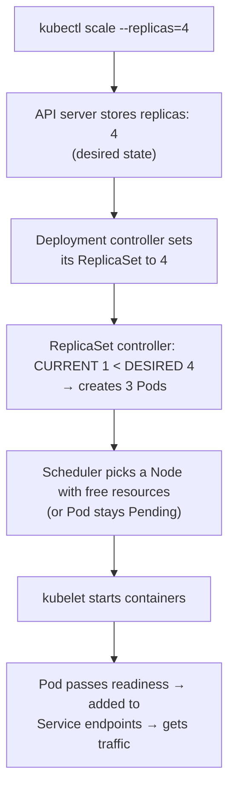

# Scaling (Kubernetes)

**Scaling** means changing how many identical copies (**replicas**) of an app run. In [[kubernetes]] you do it by changing the replica count of a [[kubernetes-deployment|Deployment]]. You don't start or stop [[kubernetes-pod|Pods]] yourself. A controller sees that the desired count and the running count differ, and closes the gap by creating or terminating Pods. Analogy: a thermostat. You set the target temperature, and the system heats or cools until the room matches. (src: [[2026-11-23-k8s-running-multiple-instances-of-your-app]]; analogy: general knowledge)

This page covers **horizontal** scaling, which changes the number of Pods. Vertical scaling gives each Pod more CPU, memory, or GPUs. (general knowledge)

## Details

### The desired-state loop

- Scaling is accomplished by changing the number of replicas in a Deployment. This number is the desired state. (src: [[2026-11-23-k8s-running-multiple-instances-of-your-app]])
- The Deployment's [[kubernetes-replicaset|ReplicaSet]] shows the gap as **DESIRED** vs **CURRENT** in `kubectl get rs`. (src: [[2026-11-23-k8s-running-multiple-instances-of-your-app]])
- Scaling out creates new Pods and schedules them to Nodes with available resources ([[kubernetes-scheduling]]). Scaling down terminates Pods. Scaling to zero terminates all of them but keeps the Deployment, so you can scale it back up later. (src: [[2026-11-23-k8s-running-multiple-instances-of-your-app]]; "keeps the Deployment": general knowledge)

What happens after `kubectl scale --replicas=4`, step by step (general knowledge; the source shows only the start and end states):

The same loop replaces Pods lost to a Node failure. A lost Pod and a scale-up both leave CURRENT below DESIRED, and the controller responds the same way. (general knowledge)

### Traffic follows automatically

- A [[kubernetes-service|Service]] load-balances across all Pods of an exposed Deployment. It continuously monitors running Pods through **endpoints**, so new replicas receive traffic and terminated ones stop receiving it. The Service itself does not change. (src: [[2026-11-23-k8s-running-multiple-instances-of-your-app]])
- Multiple replicas are what make rolling updates possible without downtime. (src: [[2026-11-23-k8s-running-multiple-instances-of-your-app]])

### Manual vs automatic

| | Who sets the replica count | Example |
| --- | --- | --- |
| Manual | A person or script | `kubectl scale deployments/<name> --replicas=4` (src: [[2026-11-23-k8s-running-multiple-instances-of-your-app]]) |
| Autoscaling | A controller, based on metrics | Kubernetes supports Pod autoscaling (src: [[2026-11-23-k8s-running-multiple-instances-of-your-app]]). The built-in **Horizontal Pod Autoscaler (HPA)** adjusts replicas from CPU or custom metrics, between a min and a max (general knowledge) |

- An autoscaler does nothing new. It writes the same replica field you would set by hand. (general knowledge)
- Related autoscalers, all general knowledge: the **cluster autoscaler** adds or removes *Nodes* when Pods are Pending or Nodes sit empty. **KEDA** scales on event and queue metrics and can scale to zero. The stock HPA keeps at least one replica unless an alpha feature is enabled.

## GPU cloud bridge

General knowledge, not from the source.

- **Scale-out can stall on GPUs.** A new inference replica needs whole free GPUs on one Node ([[kubernetes-scheduling]]). With none available, the Pod stays Pending: `get deployments` shows e.g. `READY 2/4`, and the extra traffic stays on the existing replicas. Capacity planning, a cluster autoscaler, or bare-metal provisioning has to supply Nodes, which takes minutes for a cloud VM and longer for bare metal.
- **Cold start sets how fast you can scale.** A new replica is useful only after it pulls a large [[container]] image and loads model weights into GPU memory ([[kubernetes-pod]]). Autoscalers for LLMs must act early, or keep warm spare replicas.
- **Pick the right scaling signal.** CPU usage is meaningless for a GPU server, and GPU-Util looks busy even when a replica is memory-bound ([[gpu-utilization-metrics]]). LLM platforms scale on queue depth, requests or tokens in flight, KV-cache usage, or latency ([[inference-serving]], [[kv-cache]]).
- **Scale-to-zero is a pricing decision.** At zero replicas a dedicated endpoint uses no GPU-hours, but the next request pays the full cold start. Minimum replicas > 0 means someone pays for idle GPUs: the customer on a dedicated endpoint, the provider on a serverless per-token API ([[per-token-pricing]]).
- **Scale-down can cut requests off.** A terminated Pod gets a stop signal and a grace period (30 s by default) before it is killed. Long streamed LLM responses need a longer grace period and must be drained, or users see responses cut mid-stream.
- **Quotas cap the replica count.** Max replicas × GPUs per replica must fit the tenant's GPU quota. A Kubernetes ResourceQuota rejects Pods over the limit, so the ReplicaSet stays below DESIRED with "forbidden" events. That is a different failure from Pending for lack of GPUs.
- **Metering reads the result.** Each replica's lifetime × its GPU count is the GPU-hour record for dedicated-endpoint billing. Every scale event changes the bill.

## Related

- [[kubernetes-deployment]]: owns the replica count being scaled.
- [[kubernetes-replicaset]]: the controller that turns the count into Pods.
- [[kubernetes-service]]: spreads traffic across however many replicas exist.
- [[kubernetes-scheduling]]: where new replicas land, or why they stay Pending.
- [[inference-serving]]: autoscaling as a serving responsibility; which signal to scale on.
- [[2026-11-12-sizing-a-gpu-inference-deployment]]: how many GPUs one replica needs, which multiplies into scale-out cost.
- [[control-plane]]: the reconciliation loop that does the work.

## Open questions

- HPA details: metric sources (custom/external metrics), stabilization windows, and scale-to-zero support. Needs the Kubernetes autoscaling docs.
- Which Pods does a ReplicaSet terminate first on scale-down, and how can an inference platform influence that choice?
- How do LLM-specific autoscalers (e.g. KServe, KEDA with queue metrics, provider-built ones) decide when to add GPU replicas?
