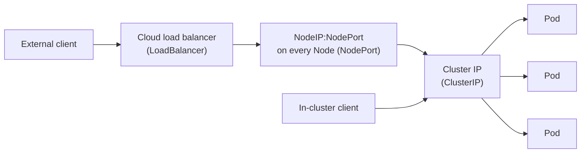

# Service (Kubernetes)

A **Service** is a [[kubernetes]] object that gives a changing group of [[kubernetes-pod|Pods]] one stable address. It defines a logical set of Pods, usually chosen by a [[kubernetes-labels-and-selectors|label selector]], and a policy for reaching them: load balancing across them, discovery by name, and optional exposure outside the cluster. Analogy: a restaurant's phone number. The staff who answer change every shift, but customers always dial the same number and someone available picks up. (src: [[2026-11-22-k8s-using-a-service-to-expose-your-app]]; analogy: general knowledge)

![[raw/assets/k8s-expose-labels.svg]]
Service `svc` (1.1.1.1) with selector `app=A` routes to all four Pods labeled `app: A`: three managed by a Deployment/ReplicaSet and one standalone Pod. The `app: B` Pod is not selected. (src: [[2026-11-22-k8s-using-a-service-to-expose-your-app]])

## Details

### Why it exists

- Pods are mortal. When a Node dies, its Pods are lost and replaced by new Pods with new IPs. Every Pod has a unique IP, so clients cannot hard-code Pod addresses. (src: [[2026-11-22-k8s-using-a-service-to-expose-your-app]])
- A Service gives loose coupling between dependent Pods: a frontend talks to the backend Service and does not care how many backend replicas exist or whether one was recreated. (src: [[2026-11-22-k8s-using-a-service-to-expose-your-app]])
- Pod IPs are not reachable from outside the cluster without a Service. (src: [[2026-11-22-k8s-using-a-service-to-expose-your-app]])

### Types: a ladder of exposure

| `spec.type` | Reachable from | Mechanism | Notes |
| --- | --- | --- | --- |
| ClusterIP (default) | Inside the cluster | Internal virtual IP | (src) |
| NodePort | Outside, `NodeIP:NodePort` | Tutorial: same port opened on each selected Node via NAT (src). Reference doc: every Node proxies that port, the same port number on every Node (general knowledge; verified: [Service](https://kubernetes.io/docs/concepts/services-networking/service/#type-nodeport)) | Superset of ClusterIP (src). Default port range 30000–32767, set by the API server flag `--service-node-port-range` (general knowledge; verified: same) |
| LoadBalancer | Outside, fixed external IP | The cloud provisions an external load balancer, if supported | Superset of NodePort (src) |
| ExternalName | n/a | DNS `CNAME` to `externalName`; no proxying | No selector (src) |

(src: [[2026-11-22-k8s-using-a-service-to-expose-your-app]] unless marked)

Each type builds on the one below it, so a LoadBalancer Service also has a NodePort and a ClusterIP. (superset relation: src; diagram: this wiki)

### Selectors and endpoints

- The set of Pods is usually defined by a label selector. Any Pod whose labels match receives traffic. (src: [[2026-11-22-k8s-using-a-service-to-expose-your-app]])
- A Service **without a selector** gets no Endpoints object, so you can point it by hand at specific backends. (src: [[2026-11-22-k8s-using-a-service-to-expose-your-app]]) Current Kubernetes tracks backends in **EndpointSlices** (and creates none automatically for selector-less Services either); the older Endpoints API the tutorial names was deprecated in v1.33 (April 2025). (general knowledge; verified: [Continuing the transition from Endpoints to EndpointSlices](https://kubernetes.io/blog/2025/04/24/endpoints-deprecation/))
- **Endpoints track the replicas.** A Service continuously monitors the running Pods through endpoints, so traffic only goes to available Pods. When a Deployment is [[kubernetes-scaling|scaled]], new Pods are added and terminated ones removed, and the Service itself does not change. In the tutorial, after scaling to 4, repeated `curl`s reach a different Pod each time. (src: [[2026-11-23-k8s-running-multiple-instances-of-your-app]]) Each `curl` opens a new connection, so this fits per-connection balancing. (general knowledge)
- **Discovery:** cluster DNS gives each Service an A/AAAA record `<service>.<namespace>.svc.<cluster-domain>`, e.g. `my-svc.my-namespace.svc.cluster.local` (`cluster.local` is the usual default domain). Pods in the same namespace can use just `my-svc`. (general knowledge; verified: [DNS for Services and Pods](https://kubernetes.io/docs/concepts/services-networking/dns-pod-service/); the source only says Services provide "service discovery")
- **How traffic is forwarded:** kube-proxy, a component on each Node, installs packet-rewriting rules that send traffic for the cluster IP to one of the backend Pod IPs. Linux modes: `iptables` (default), `nftables` (GA since v1.33), and `ipvs` (deprecated since v1.35, removal planned for v1.40). `iptables` and `nftables` pick a backend at random; `ipvs` defaults to round-robin. Balancing happens per connection (layer 4: the TCP connection level), not per HTTP request: every request on one open connection goes to the same Pod. (general knowledge; verified: [Virtual IPs and Service Proxies](https://kubernetes.io/docs/reference/networking/virtual-ips/), [Scheduling the removal of the kube-proxy IPVS backend](https://kubernetes.io/blog/2026/11/16/ipvs-removal/))
- **Readiness:** a readiness probe is a periodic check the [[kubelet]] runs against a container (an HTTP call, TCP connect, gRPC call, or command) to ask "can you take traffic yet?". A Pod that fails it is marked not-ready in the EndpointSlice and kube-proxy sends it no traffic, so a Pod that is starting up gets no requests. (general knowledge; verified: [Liveness, Readiness, and Startup Probes](https://kubernetes.io/docs/concepts/configuration/liveness-readiness-startup-probes/))
- **During a rolling update**, the Service sends traffic only to Pods that can handle requests, which keeps the app reachable while Pods are replaced. Every replaced Pod gets a new IP, while the Service IP stays the same. (src: [[2026-11-27-k8s-performing-a-rolling-update]]) What "can handle requests" means in practice is the readiness check above. (general knowledge) See [[kubernetes-rolling-update]].

### Lifecycle is separate from the workload

- `kubectl expose deployment/<name> --type=NodePort --port 8080` creates a Service for an existing [[kubernetes-deployment|Deployment]]. (src: [[2026-11-22-k8s-using-a-service-to-expose-your-app]])
- Deleting the Service removes outside access, but the Pods keep running because the Deployment still manages them. (src: [[2026-11-22-k8s-using-a-service-to-expose-your-app]])

## GPU cloud bridge

All general knowledge; not from the source.

- **An inference endpoint's address is a Service** (or something built on one) in front of the Deployment of replica Pods ([[inference-serving]]). Autoscaling and Node failures change the Pods; the URL customers hold does not change.
- **Readiness is the cold-start guard.** An inference Pod can take minutes to load weights ([[kubernetes-pod]]). Its readiness probe should fail until the model is loaded, or the Service will send requests to a replica that cannot answer.
- **Layer-4 balancing is a poor fit for LLMs.** Requests vary hugely in length and are streamed, and replicas hold different [[kv-cache|KV-cache]] prefixes. Per-connection balancing (random or round-robin, depending on the kube-proxy mode) ignores all of this, so inference platforms add request-level, cache-aware routing on top, e.g. the Gateway API Inference Extension ([[inference-optimization]]).
- **LoadBalancer on bare metal.** Hyperscalers fulfil `type: LoadBalancer` with their own load balancers. A bare-metal GPU cloud needs its own implementation (MetalLB, or a provider-built controller), which belongs to its provisioning and networking stack.
- **Tenancy:** Services are namespaced. A multi-tenant platform also needs network policy, so tenant A's Pods cannot reach tenant B's Services just by knowing the DNS name.
- **Scale-down race.** Removing a Pod from endpoints and telling it to stop happen at about the same time, so a few new requests can still reach a Pod that is shutting down. Inference Pods usually add a short pre-stop delay and drain in-flight streams before exiting ([[kubernetes-scaling]]).

## Related

- [[kubernetes-labels-and-selectors]]: how a Service picks its Pods.
- [[kubernetes-pod]]: the backends; why their IPs cannot be relied on.
- [[kubernetes-deployment]]: keeps the backends running; separate object from the Service.
- [[kubernetes-scaling]]: changes how many backends exist; endpoints follow automatically.
- [[kubernetes-rolling-update]]: replaces every backend, one step at a time, behind the same address.
- [[kubernetes-node]]: where NodePort ports open.
- [[inference-serving]]: load balancing across replicas, one of the serving responsibilities.
- [[kubectl]]: `expose`, `get services`, `describe services`, `delete service`.

## Open questions

- What sits between a customer's HTTPS request and the Service in real inference platforms (ingress, API gateway, auth, rate limiting)?
- How fast does a failed Pod disappear from a Service's backends, and how many requests fail in between?
