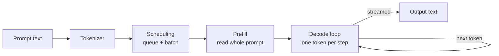

# LLM inference

**LLM inference** is *running* a trained large language model: a prompt goes in and generated text (or code, a summary, a translation) comes out. Training is how the model learns its parameters (the billions of numbers that make up the model). Inference uses those parameters without changing them. Analogy: training writes the cookbook, inference cooks a dish from it on request. Strictly, inference is only the computation. The production system around it is [[inference-serving]]. (src: [[2026-11-21-what-is-llm-inference]]) Inference runs continuously on every request, so its cost keeps growing with traffic, unlike the mostly one-time cost of training ([[training-vs-inference]]). (src: [[2026-11-22-training-vs-inference]])

## Details

### Vocabulary

- **Token:** the unit the model reads and writes, usually a word or part of a word. A **tokenizer** converts text to token IDs on the way in and back to text on the way out. (general knowledge)
- **Forward pass:** one run of the input through every layer of the model. One forward pass produces a probability distribution over which token comes next. (src: [[2026-11-21-what-is-llm-inference]])
- **Prompt:** the user's input, usually natural language. (src: [[2026-11-21-what-is-llm-inference]])

### What happens to one request

The handbook's visualizer shows four stages (src: [[2026-11-21-what-is-llm-inference]]):

- Tokenizing runs on CPU and is cheap. Scheduling is a serving decision: which requests share a GPU pass ([[inference-batching]]). (general knowledge)
- Prefill and decode are the GPU work. Prefill reads the whole prompt in parallel. Decode generates one token at a time, reusing the [[kv-cache]]. See [[prefill-and-decode]]. (src: [[2026-11-12-transformer-inference-arithmetic]], [[2026-11-21-what-is-llm-inference]])
- Each generated token costs about 2 [[flops]] per model parameter. With a small batch, the step time is set by reading all the weights from memory rather than by compute ([[gpu-performance-regimes]]). (src: [[2026-11-12-transformer-inference-arithmetic]])

### Inference vs serving: the interview answer

| | Inference | Serving |
| --- | --- | --- |
| What it is | The computation: tokens in, next-token distribution out, repeated through prefill and decode | Everything needed to offer that computation as a reliable production service |
| Runs where | Anywhere, even a Jupyter notebook with no server | Behind an API (HTTP/gRPC), on a fleet of replicas |
| Concerns | Speed per token, memory, numerical precision | Queuing, batching across users, load balancing, autoscaling, model versions, health checks, observability, resource allocation |
| Who owns it | The model + inference engine | Inference framework + platform/control plane |

(src: [[2026-11-21-what-is-llm-inference]]; "who owns it" row: general knowledge)

## Related

- [[inference-serving]]: the production system around inference.
- [[prefill-and-decode]]: the two GPU phases of one request.
- [[inference-frameworks]]: software that performs inference and usually serving too (vLLM, SGLang, TensorRT-LLM, MAX).
- [[inference-optimization]]: techniques to make inference faster and cheaper.
- [[inference-latency-model]]: how long one decode step takes, from first principles.
- [[training-vs-inference]]: how inference differs from training in workload, cost, and what the control plane does with each.
- [[fine-tuning]]: changes weights, so it is training, not inference.
