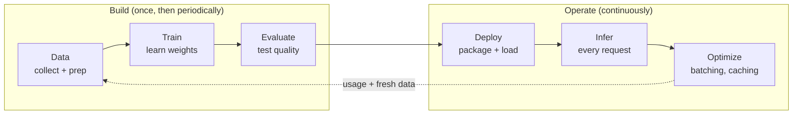

# Training vs inference

**Training** builds a model by adjusting its parameters (weights) over huge datasets. **Inference** uses the finished model, without changing it, to answer new inputs. Analogy: training is building a factory, and inference is running its production line every day. You build the factory once, but you pay to run the line for as long as orders come in. For a GPU cloud the two are different products with different customers, job shapes, and meters. (src: [[2026-11-22-training-vs-inference]]; analogy: general knowledge)

## Details

### The lifecycle

- The handbook's visualizer shows this loop. You measure **quality** while building and **latency and cost** in production. (src: [[2026-11-22-training-vs-inference]])
- The fuller order is training → alignment → optional [[fine-tuning]] → evaluation → deployment → inference. (src: [[2026-11-22-training-vs-inference]])
- The handoff between the halves is a **model artifact**: weight files plus config. The training side writes it, and the serving side loads it ([[inference-serving]]). In a cloud this usually passes through object storage or a model registry. (general knowledge)

### Side by side

| | Training | Inference |
| --- | --- | --- |
| Purpose | Teach the model | Use the model |
| Data | Huge datasets | New user inputs |
| Compute | Long, expensive GPU/TPU jobs | Real-time, repeated workloads |
| Cost model | Mostly one-time | Ongoing, scales with traffic |
| Hardware | Multi-node clusters | Smaller clusters, optimized runtimes and caches |
| Time | Hours to weeks per job | Milliseconds to seconds per request |
| Tools | PyTorch, JAX, DeepSpeed, Megatron | vLLM, SGLang, TensorRT LLM, MAX, LMDeploy ([[inference-frameworks]]) |

(src: [[2026-11-22-training-vs-inference]])

- **Weights:** training changes them, and inference never does. [[fine-tuning]] changes them, so it counts as training. (src: [[2026-11-22-training-vs-inference]])
- **Which costs more over time:** inference often does. Training is paid roughly once, while inference spends GPU compute, memory, and network bandwidth on every request, especially with heavy use or long prompts. (src: [[2026-11-22-training-vs-inference]])
- **Hardware bottleneck:** training pushes large batches of examples through the model, so it tends to be compute-bound (general knowledge). Inference decode with small batches is memory-bandwidth-bound: each new token rereads all the weights ([[prefill-and-decode]], [[gpu-performance-regimes]]). (src: [[2026-11-12-transformer-inference-arithmetic]])
- **"Smaller clusters" is a generalization.** A model too large for one GPU still needs a multi-GPU replica (e.g. 52B on 4× A100 in [[model-parallelism]]). (src: [[2026-11-12-transformer-inference-arithmetic]]) The difference is that inference replicas are many and independent, while a training job is one large coupled unit. (general knowledge)

### What it means for the control plane

The handbook gives the contrast, and the mapping to domains below is this wiki's (general knowledge).

| Domain | Training workload | Inference workload |
| --- | --- | --- |
| **Provisioning** | Allocate a whole cluster: N nodes × 8 GPUs with a fast interconnect between nodes, for a fixed window. It is all-or-nothing (gang scheduling), and topology matters as much as GPU count. | Create an endpoint: a model, a GPU SKU, a replica size from [[gpu-memory-capacity]], and min/max replicas. Placement is chosen to be near users. |
| **Tenancy and quotas** | Quota is GPUs or nodes per tenant, often as reserved capacity blocks with a start and end date. Jobs may tolerate preemption if they checkpoint. | Quota is rate limits (requests or tokens per minute) plus max replicas or GPUs. Shared replicas mix tenants in one batch ([[inference-batching]]). |
| **Lifecycle** | A batch job (Kubernetes Job, Slurm). One bad GPU can stall or crash the whole job, so the job checkpoints, the failed node is replaced, and the job resumes. Node health checks gate admission. | A long-running service (Kubernetes Deployment). The system does rolling model upgrades, health checks, autoscaling, and handles cold start while weights load. A bad node loses one replica, not the service. |
| **Metering and billing** | GPU-hours for the reserved window, usually committed in advance and paid whether used or not. | Per token (serverless) or per endpoint GPU-hour (dedicated). It is continuous and traffic-driven ([[per-token-pricing]]). |
| **What "good" looks like** | High utilization over a long job, few restarts, and fast recovery. | Latency targets met at the lowest cost per token, with no dropped requests. |

## Related

- [[llm-inference]]: the "use the model" half, in detail.
- [[fine-tuning]]: training-shaped work done on an existing model.
- [[inference-serving]]: the production system around inference, and the side of the lifecycle the control plane runs continuously.
- [[inference-frameworks]]: the inference tool column of the table.
- [[per-token-pricing]]: how the ongoing inference cost is billed.
- [[model-parallelism]]: why some inference replicas still span several GPUs.

## Open questions

- What is the real lifetime training-vs-inference cost split for a widely used model? The source gives no numbers.
- How do GPU clouds package training capacity (reserved blocks, spot capacity, managed Slurm or Kubernetes clusters), and what interconnect guarantees come with it? Needs provider docs.
- How does checkpoint and restart work at cluster scale, and how does the control plane detect and replace a failing node mid-job?
