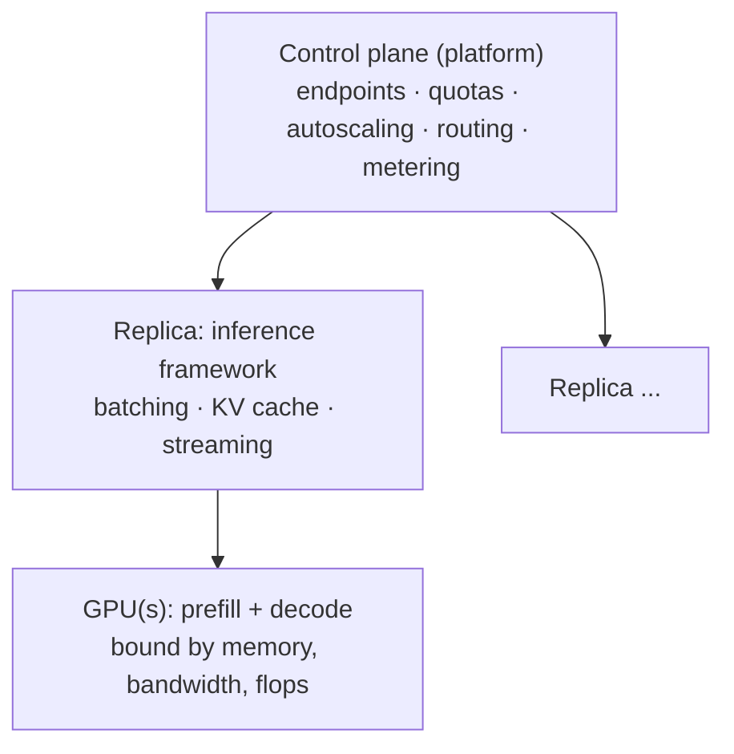
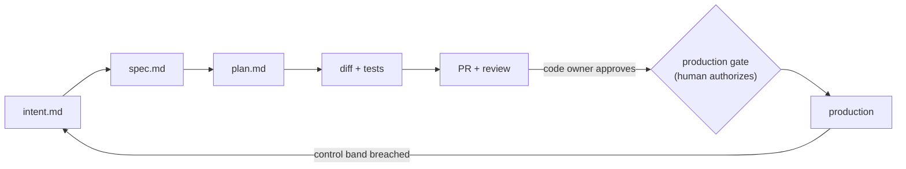

# Overview

A lifelong knowledge base, organized into areas. Each area below has its own big-picture synthesis.

| Area | Scope | Sources | Entry points |
| --- | --- | --- | --- |
| [[#GPU cloud]] (primary) | How GPU clouds are built and run: provisioning APIs, tenancy and quotas, Kubernetes/bare-metal lifecycle, metering and billing | 7 | [[control-plane]], [[inference-serving]], [[kubernetes]] |
| Software delivery ([[#Software delivery and AI agents]]) | How software is planned, built, tested, shipped, maintained | 1 | [[software-development-lifecycle]], [[deployment-gates]] |
| AI agents ([[#Software delivery and AI agents]]) | How coding agents work and are controlled | 1 (shared with software delivery) | [[agent-guardrails]], [[claude-code]] |

Where areas meet (general knowledge): a GPU cloud's control plane is software shipped through an SDLC; rollbacks and gated rollouts land on Kubernetes Deployments ([[deployment-gates]], [[kubernetes-deployment]]); alerting on control bands depends on choosing metrics that mean what you think ([[control-bands]], [[gpu-utilization-metrics]]).

## GPU cloud

**Goal:** working knowledge of GPU cloud control plane engineering across four domains: provisioning APIs, tenancy and quotas, Kubernetes/bare-metal lifecycle, and metering and billing.

### The product: what a GPU actually does

A GPU's real throughput is limited by one of three things: compute, memory bandwidth, or software overhead ([[gpu-performance-regimes]]). Headline numbers like "312 TFLOPS" hold only under narrow conditions ([[flops]], [[nvidia-a100]]). (src: [[2026-11-10-deep-learning-brrrr-first-principles]])

Control-plane consequences (general knowledge unless cited):

- **Metering-billing:** "busy" is ambiguous. `nvidia-smi` GPU-Util measures time-busy, not capacity used (src: [[2026-11-10-deep-learning-brrrr-first-principles]]), so dashboards and idle-detection have to choose their metrics deliberately. See [[gpu-utilization-metrics]].
- **Provisioning:** SKUs differ in form factor, memory size, and bandwidth. Which one fits depends on the customer's regime. See [[memory-bandwidth]].
- **Lifecycle:** [[nvidia-smi]] is the first-line tool for node health and "slow GPU" triage.

### Serving the product: inference arithmetic

The second source turns the same physics into a sizing procedure for model serving, which is where most GPU-cloud demand now comes from. (src: [[2026-11-12-transformer-inference-arithmetic]])

The chain is four arithmetic steps, laid out end to end in [[2026-11-12-sizing-a-gpu-inference-deployment]]:

1. **Weights → GPUs.** 2 bytes per parameter at 16-bit; a 52B model is 104 GB, so it cannot fit on a 40 GB card ([[gpu-memory-capacity]]).
2. **Leftover memory → concurrency.** The [[kv-cache]] costs ~2 MB per token for that model (exactly 2,097,152 bytes), so the remaining 56 GB on four cards holds ≈26,700 cached tokens, about 13 requests of 2048 tokens (the source prints 23,000, an arithmetic slip; see [[gpu-memory-capacity]]).
3. **Concurrency → cost.** Below ~208 tokens per forward pass (at decode: a batch of ~208 sequences) the GPU is memory-bandwidth-bound; above it, flops-bound and cheaper per token ([[inference-batching]]).
4. **GPUs → latency floor.** Tensor parallelism cuts compute by `1/N` but adds a fixed four-per-layer communication cost, so more GPUs stop helping past a point ([[model-parallelism]], [[inference-latency-model]]).

Control-plane consequences (general knowledge unless cited):

- **Quotas are memory limits.** Concurrency follows from `(VRAM − weights) ÷ (cache per token × context)`, not from a GPU count (capacity arithmetic: src: [[2026-11-12-transformer-inference-arithmetic]]; quota framing: general knowledge).
- **Multi-GPU replicas are a placement constraint.** A model too large for one card needs several GPUs (the 52B example needs at least three A100-40GB for its weights and uses four, src: [[2026-11-12-transformer-inference-arithmetic]]), ideally on one NVLink-connected node. On Kubernetes that is one Pod requesting N GPUs, placed all-or-nothing on one Node; replicas spanning several Nodes need true gang scheduling ([[kubernetes-scheduling]]). Topology matters, not just GPU count. (general knowledge)
- **Tokens/second is the inference-native metering unit**, and it is not fixed per SKU: it depends on the batch the provider can pack (src: [[2026-11-12-transformer-inference-arithmetic]]; product framing: general knowledge).
- **Memory-bound replicas look busy.** GPU-Util can read high while the GPU does a fraction of its peak flops ([[gpu-utilization-metrics]]).

### The layer the control plane owns: serving

The third source adds vocabulary for the layer above the GPU arithmetic. **Inference** is the computation: tokens in, next-token probabilities out, through [[prefill-and-decode]] ([[llm-inference]]). **Serving** is everything that turns it into a production service: an API surface (HTTP/gRPC), request queuing and scheduling, batching across concurrent requests, load balancing across replicas, autoscaling, model loading and version management, health checks, observability, resource allocation ([[inference-serving]]). Frameworks like vLLM, SGLang, TensorRT LLM, and MAX handle both, which is why "inference framework" and "serving framework" often name the same systems ([[inference-frameworks]]). (src: [[2026-11-21-what-is-llm-inference]])

Control-plane consequences (general knowledge unless cited):

- **The serving list is the control plane's scope.** Each serving responsibility maps to one of the four domains; the mapping table is in [[inference-serving]].
- **Two products, two meters.** Serverless APIs bill per token and carry the utilization risk; self-hosted customers rent GPU-hours and carry it themselves (src for per-token serverless: [[2026-11-21-what-is-llm-inference]]). See [[per-token-pricing]].
- **Optimizations move capacity.** Continuous batching, quantization, and prefix caching raise tokens per GPU, so GPU-denominated quotas and token-denominated prices drift apart. See [[inference-optimization]] for the reading roadmap.

### Two workloads: training vs inference

A model's life has two phases. **Training** (build) runs once or periodically, as long, expensive jobs on GPU/TPU clusters, and is "more or less a one-time expense". **Inference** (operate) runs on every request, in milliseconds to seconds, and its cost scales with traffic, so it can become the larger long-term expense. [[fine-tuning]] changes weights, so it counts as training. See [[training-vs-inference]]. (src: [[2026-11-22-training-vs-inference]]) The source's durations are rough: frontier pretraining runs for months, and long or reasoning-heavy responses take tens of seconds (see [[training-vs-inference#Contradictions]]).

Control-plane consequences (general knowledge):

- **Two job shapes.** Training is an all-or-nothing batch job: a gang-scheduled cluster, checkpoints, and reserved GPU-hours. Inference is an always-on service: autoscaled replicas, rolling upgrades, and per-token or endpoint billing. Every domain needs a version of each; the per-domain table is in [[training-vs-inference]].
- **The handoff is a model artifact.** Training or fine-tuning writes weights, and serving loads them. Storage, versioning, and cold start sit at that seam.

### Where workloads run: Kubernetes Pods and Nodes

The fifth source starts the lifecycle domain. In [[kubernetes]], a [[kubernetes-node|Node]] is a worker machine, virtual or physical, and a [[kubernetes-pod|Pod]] is the smallest unit it runs: one or more [[container|containers]] sharing an IP and storage, always on one Node. The [[control-plane]] schedules Pods onto Nodes by free resources ([[kubernetes-scheduling]]). Each Node runs a [[kubelet]] and a container runtime ([[containerd]]). When a Node fails, its Pods are not moved: identical replacements are scheduled elsewhere. A [[kubernetes-deployment|Deployment]] creates the Pods in the first place. [[kubectl]] is the tool for inspecting all of it. (src: [[2026-11-22-k8s-viewing-pods-and-nodes]]) Replacement happens only for Pods a controller such as a Deployment manages; a bare Pod on a dead Node is not recreated. (general knowledge; verified: [Kubernetes docs: Pods](https://kubernetes.io/docs/concepts/workloads/pods/))

Control-plane consequences (general knowledge):

- **"Control plane" has two levels.** Kubernetes has its own control plane (API server, scheduler, controllers). A GPU cloud's control plane sits above it and translates "create an endpoint for tenant A" into Kubernetes objects, checks quotas, and meters the result ([[control-plane]]).
- **Map the earlier pages onto Kubernetes objects.** A GPU Node is usually an 8-GPU bare-metal server. An inference replica is one Pod requesting GPUs, and an endpoint is a Deployment of such Pods. A Node failure costs a cold start while a replacement Pod reloads weights.
- **GPUs are scheduled as whole, reserved units.** A requested GPU is held even when idle, so GPU-hour billing and capacity follow Pod lifetimes, not utilization ([[gpu-utilization-metrics]]). Multi-Node jobs need gang scheduling (all Pods or none): add-ons such as Kueue or Volcano, or the built-in Gang Scheduling feature, beta since v1.37 and off by default ([[kubernetes-scheduling]]; verified: [Kubernetes docs: Gang Scheduling](https://kubernetes.io/docs/concepts/scheduling-eviction/gang-scheduling/)).

### Reaching workloads: Services and labels

Pods get new IPs whenever they are replaced, and Pod IPs are not reachable from outside the cluster. A [[kubernetes-service|Service]] gives a set of Pods one stable address, load-balances across them, and lets clients discover them. Its `type` sets how far it reaches: ClusterIP (in-cluster) ⊂ NodePort (a port on every Node) ⊂ LoadBalancer (a cloud load balancer); ExternalName is only a DNS alias. A Service picks its Pods with a selector over key/value [[kubernetes-labels-and-selectors|labels]], Kubernetes' grouping primitive. Deleting a Service removes the route in, not the Pods. (src: [[2026-11-22-k8s-using-a-service-to-expose-your-app]])

Control-plane consequences (general knowledge):

- **An inference endpoint = Deployment + Service.** Replicas churn underneath; the customer's address does not. Readiness probes keep a Service from routing to a replica that is still loading weights.
- **Per-connection balancing is not enough for LLMs.** Long, streamed requests and per-replica [[kv-cache]] contents call for request-level, cache-aware routing above the Service ([[inference-serving]]).
- **Labels are the cross-domain tagging tool.** Node labels select GPU SKUs (provisioning), tenant labels group objects (tenancy), version labels drive rollouts (lifecycle), and cost tools attribute GPU-hours by label (metering). Because labels are mutable, billing-relevant ones must be set and guarded by the platform.

### Sizing the fleet: scaling replicas

[[kubernetes-scaling|Scaling]] means changing one number: a Deployment's replica count, its desired state. Its [[kubernetes-replicaset|ReplicaSet]] compares DESIRED with CURRENT and creates or terminates Pods to close the gap. New Pods are scheduled to Nodes with free resources, and scaling to zero terminates all Pods. The Service tracks running Pods through endpoints, so traffic spreads across new replicas automatically and the address never changes. Multiple replicas also make zero-downtime rolling updates easier. Autoscaling exists; it writes the same number automatically. (src: [[2026-11-23-k8s-running-multiple-instances-of-your-app]])

Control-plane consequences (general knowledge):

- **The replica count is the knob every domain touches.** Provisioning sets min/max replicas, quotas cap them (max replicas × GPUs per replica), autoscalers move them, and GPU-hour metering integrates them over time.
- **On GPUs, scale-out is not instant and not guaranteed.** New replicas stay Pending without whole free GPUs ([[kubernetes-scheduling]]), then pay a cold start loading weights. LLM autoscalers scale early and on queue/KV-cache signals, not CPU or GPU-Util ([[gpu-utilization-metrics]]).
- **Scale-to-zero is a pricing decision.** It saves idle GPU-hours at the cost of a cold start. Someone pays for minimum replicas: the customer on a dedicated endpoint, the provider on a serverless API ([[per-token-pricing]]).
- **Scale-down must drain.** Long streamed responses need a longer termination grace period than the 30 s default, or they are cut off mid-stream.

### Coverage so far

| Domain | Status |
| --- | --- |
| Provisioning APIs | GPU/SKU background, inference sizing rules, the serving responsibilities an endpoint API must cover, and training-cluster vs endpoint provisioning shapes (unsourced mapping); no actual API sources yet |
| Tenancy and quotas | Concurrency-as-memory from inference arithmetic; serving-side queuing/rate limits and training capacity blocks identified but unsourced |
| Kubernetes and bare-metal lifecycle | Kubernetes basics sourced (Pods, Nodes, kubelet, runtime, scheduling by free resources, replacement on Node failure, Services and Service types, labels/selectors, manual scaling via Deployment/ReplicaSet, endpoints, kubectl triage); autoscaling (HPA/cluster autoscaler), rolling updates, GPU device plugins, gang scheduling, Node health/drain, readiness probes, graceful termination, and bare-metal provisioning still unsourced |
| Metering and billing | Utilization metrics, tokens-vs-GPU-hours reasoning, per-token vs GPU-hour products, inference as the recurring cost; no billing-pipeline sources |

### Suggested next sources

- A provider's GPU instance docs and pricing page (e.g. AWS EC2 P-series, GCP A3, CoreWeave): provisioning, billing granularity, and how they present concurrency.
- Modular LLM Inference Handbook follow-on chapters: continuous batching, prefix caching, quantization, routing, serverless vs self-hosted (ordered list in [[inference-optimization]]).
- vLLM / TensorRT LLM documentation on continuous batching (per-step scheduling) and PagedAttention (KV-cache memory management): the engine half of serving, from the engine authors.
- Kubernetes Basics Module 2 (Deployments) and Module 6 (rolling updates); Kubernetes autoscaling docs (HPA, cluster autoscaler) and an LLM autoscaler (KServe or KEDA); Kubernetes docs on device plugins, the NVIDIA GPU Operator, and gang scheduling (built-in Gang Scheduling / PodGroup API, Kueue, Volcano): lifecycle.
- Gateway API Inference Extension / llm-d / KServe docs: how inference platforms route requests above a plain Service.
- Kubernetes ResourceQuota and cloud quota docs: tenancy and quotas.
- NVIDIA DCGM docs: real utilization metrics for metering.
- GPU cloud docs on training capacity (reserved clusters, capacity blocks, managed Slurm/Kubernetes): the training half of provisioning, quotas, and lifecycle.

## Software delivery and AI agents

**Goal:** understand how software gets from idea to production and how AI coding agents change that process, at a beginner level. The two areas share their first source.

### The bottleneck moves

The [[software-development-lifecycle]] (SDLC) runs six stages: plan, design, build, test, deploy, maintain. Its process was built when writing code was the most time-consuming and expensive stage, with each stage owned by a different role. Coding agents collapse build to hours, so the human-speed stages around it (requirements, review, release) become the constraint. Humans reviewing every line gives way to layered agent review, with human review reserved for regulated and critical code. (src: [[2026-11-24-ai-native-sdlc-playbook]])

![[raw/assets/sdlc-bottleneck-shift.png]]
Before agents, Build is the longest of six stages. After agents, it shrinks to a sliver and the other stages keep their length. (src: [[2026-11-24-ai-native-sdlc-playbook]])

### The AI-native answer: three mechanisms

1. **[[artifact-chain]].** Each stage ends by committing an artifact, and that commit starts the next stage (an accepted `intent.md` triggers the design pass, an approved `spec.md` triggers plan mode, a merged PR triggers the pipeline). The chain of commits is the audit trail, and git and PR history supply the stage metrics. (src: [[2026-11-24-ai-native-sdlc-playbook]])
2. **[[agent-guardrails]].** Advisory instructions (`CLAUDE.md`, skills) make compliance likely and violations rare; deterministic controls (hooks, permissions, sandbox, branch protection) make violations close to impossible. The agent that wrote the code has no way to approve it: a human approves through branch protection. The agent's own configuration is regression-tested with [[evals]]. (src: [[2026-11-24-ai-native-sdlc-playbook]])
3. **[[deployment-gates]].** The agent acts up to the production gate, never past it: free in development, prepare-only in production. Rollback is the most rehearsed path. (src: [[2026-11-24-ai-native-sdlc-playbook]])

The loop closes in maintenance: a version-controlled, unit-tested script (no model involved) watches one metric against [[control-bands]]. The size of a breach sets the response: at 1σ the script only logs, at 2σ it invokes Claude read-only to diagnose, at 3σ Claude may act, but only by opening a PR into the review gate or triggering a pre-approved runbook. The diagnosis is written as the next `intent.md`. (src: [[2026-11-24-ai-native-sdlc-playbook]])

The single source so far is a vendor playbook built around [[claude-code]]. Its control design is general; its speed claims are the vendor's. (general knowledge)

### Coverage so far

| Topic | Status |
| --- | --- |
| SDLC fundamentals | Six stages and a beginner glossary, from an AI-native perspective only; no neutral source on traditional practice (agile, DevOps, DORA) |
| Agent controls | Advisory vs deterministic layers, managed settings, separation of duties; one vendor's implementation |
| Deploy and operations | Tiered autonomy, approval hooks, rollback, σ-band detection; no SRE or release-engineering source yet |
| Agent evaluation | Eval suite design for agent configuration; no general evals source |

### Suggested next sources

- DORA research / *Accelerate* (Forsgren, Humble, Kim): the delivery metrics the playbook measures against.
- Google SRE book, chapters on monitoring, alerting, and release engineering: control bands, SLOs, and rollouts from the operations side.
- An SPC / control-chart primer covering the Western Electric rules.
- Anthropic's companion articles: "How Anthropic secures its AI-native SDLC" and "The enterprise guide to securing coding agents".
- Claude Code docs on hooks, permissions, and sandboxing: the mechanics behind [[agent-guardrails]].
