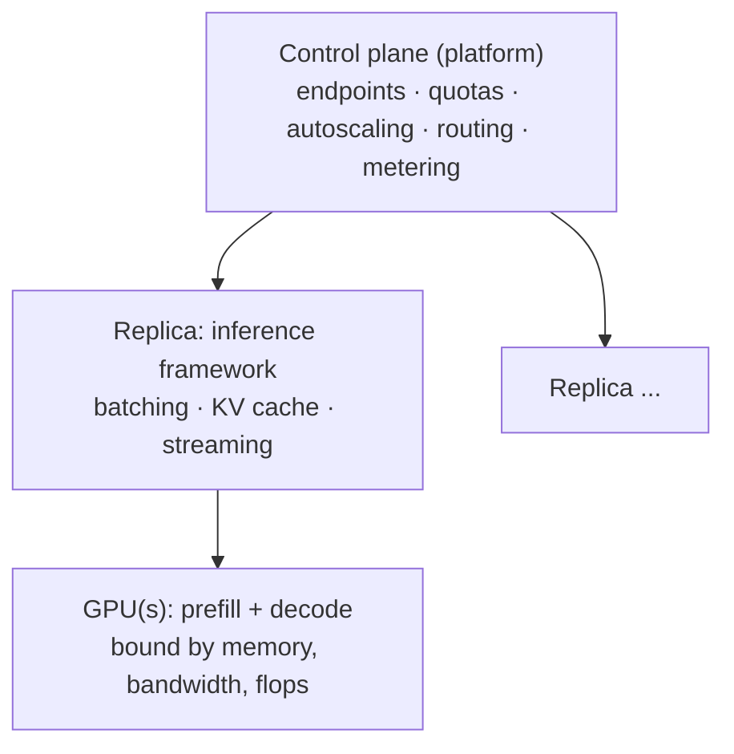

# Overview

**Goal:** working knowledge of GPU cloud control plane engineering across four domains: provisioning APIs, tenancy and quotas, Kubernetes/bare-metal lifecycle, and metering and billing.

## The product: what a GPU actually does

A GPU's real throughput is limited by one of three things: compute, memory bandwidth, or software overhead ([[gpu-performance-regimes]]). Headline numbers like "312 TFLOPS" hold only under narrow conditions ([[flops]], [[nvidia-a100]]). (src: [[2026-11-10-deep-learning-brrrr-first-principles]])

Control-plane consequences (general knowledge unless cited):

- **Metering-billing:** "busy" is ambiguous. `nvidia-smi` GPU-Util measures time-busy, not capacity used (src: [[2026-11-10-deep-learning-brrrr-first-principles]]), so dashboards and idle-detection have to choose their metrics deliberately. See [[gpu-utilization-metrics]].
- **Provisioning:** SKUs differ in form factor, memory size, and bandwidth. Which one fits depends on the customer's regime. See [[memory-bandwidth]].
- **Lifecycle:** [[nvidia-smi]] is the first-line tool for node health and "slow GPU" triage.

## Serving the product: inference arithmetic

The second source turns the same physics into a sizing procedure for model serving, which is where most GPU-cloud demand now comes from. (src: [[2026-11-12-transformer-inference-arithmetic]])

The chain is four arithmetic steps, laid out end to end in [[2026-11-12-sizing-a-gpu-inference-deployment]]:

1. **Weights → GPUs.** 2 bytes per parameter at 16-bit; a 52B model is 104 GB, so it cannot fit on a 40 GB card ([[gpu-memory-capacity]]).
2. **Leftover memory → concurrency.** The [[kv-cache]] costs ~2 MB per token for that model, so the remaining 56 GB on four cards is ~23,000 cached tokens.
3. **Concurrency → cost.** Batching below ~208 tokens in flight leaves the GPU memory-bandwidth-bound; above it, flops-bound and cheaper per token ([[inference-batching]]).
4. **GPUs → latency floor.** Tensor parallelism cuts compute by `1/N` but adds a fixed four-per-layer communication cost, so more GPUs stop helping past a point ([[model-parallelism]], [[inference-latency-model]]).

Control-plane consequences (general knowledge unless cited):

- **Quotas are memory limits.** Concurrency follows from `(VRAM − weights) ÷ (cache per token × context)`, not from a GPU count (src: [[2026-11-12-transformer-inference-arithmetic]]).
- **Multi-GPU replicas are gang-scheduled.** A model too large for one card needs all the GPUs of a node, wired with NVLink — a topology constraint, not a quantity constraint. (general knowledge)
- **Tokens/second is the inference-native metering unit**, and it is not fixed per SKU: it depends on the batch the provider can pack (src: [[2026-11-12-transformer-inference-arithmetic]]; product framing: general knowledge).
- **Memory-bound replicas look busy.** GPU-Util can read high while the GPU does a fraction of its peak flops ([[gpu-utilization-metrics]]).

## The layer the control plane owns: serving

The third source adds vocabulary for the layer above the GPU arithmetic. **Inference** is the computation: tokens in, next-token probabilities out, through [[prefill-and-decode]] ([[llm-inference]]). **Serving** is everything that turns it into a production service: API, queuing and scheduling, batching across requests, load balancing, autoscaling, model versioning, health checks, observability, resource allocation ([[inference-serving]]). Engines like vLLM, SGLang, TensorRT-LLM, and MAX do both on each replica ([[inference-frameworks]]). (src: [[2026-11-21-what-is-llm-inference]])

Control-plane consequences (general knowledge unless cited):

- **The serving list is the job description.** Each serving responsibility maps to one of the four domains; the mapping table is in [[inference-serving]].
- **Two products, two meters.** Serverless APIs bill per token and carry the utilization risk; self-hosted customers rent GPU-hours and carry it themselves (src for per-token serverless: [[2026-11-21-what-is-llm-inference]]). See [[per-token-pricing]].
- **Optimizations move capacity.** Continuous batching, quantization, and prefix caching raise tokens per GPU, so GPU-denominated quotas and token-denominated prices drift apart. See [[inference-optimization]] for the reading roadmap.

## Two workloads: training vs inference

A model's life has two phases. **Training** (build) runs once or periodically: it is a long job on multi-node clusters and is mostly a one-time cost. **Inference** (operate) runs on every request, in milliseconds to seconds, and costs money for as long as there is traffic, so it often becomes the larger expense over time. [[fine-tuning]] changes weights, so it counts as training. See [[training-vs-inference]]. (src: [[2026-11-22-training-vs-inference]])

Control-plane consequences (general knowledge):

- **Two job shapes.** Training is an all-or-nothing batch job: a gang-scheduled cluster, checkpoints, and reserved GPU-hours. Inference is an always-on service: autoscaled replicas, rolling upgrades, and per-token or endpoint billing. Every domain needs a version of each; the per-domain table is in [[training-vs-inference]].
- **The handoff is a model artifact.** Training or fine-tuning writes weights, and serving loads them. Storage, versioning, and cold start sit at that seam.

## Coverage so far

| Domain | Status |
| --- | --- |
| Provisioning APIs | GPU/SKU background, inference sizing rules, the serving responsibilities an endpoint API must cover, and training-cluster vs endpoint provisioning shapes (unsourced mapping); no actual API sources yet |
| Tenancy and quotas | Concurrency-as-memory from inference arithmetic; serving-side queuing/rate limits and training capacity blocks identified but unsourced |
| Kubernetes and bare-metal lifecycle | Not covered beyond nvidia-smi, gang scheduling, the lifecycle rows of serving, and the batch-job vs service contrast |
| Metering and billing | Utilization metrics, tokens-vs-GPU-hours reasoning, per-token vs GPU-hour products, inference as the recurring cost; no billing-pipeline sources |
| Career | Interview talking points on GPU performance, capacity, batching, parallelism, inference vs serving, and training vs inference |

## Suggested next sources

- A provider's GPU instance docs and pricing page (e.g. AWS EC2 P-series, GCP A3, CoreWeave): provisioning, billing granularity, and how they present concurrency.
- Modular LLM Inference Handbook follow-on chapters: continuous batching, prefix caching, quantization, routing, serverless vs self-hosted (ordered list in [[inference-optimization]]).
- vLLM / TensorRT-LLM documentation on continuous batching and paged attention: the scheduling half of serving, from the engine authors.
- Kubernetes docs on device plugins, the NVIDIA GPU Operator, and gang scheduling: lifecycle.
- Kubernetes ResourceQuota and cloud quota docs: tenancy and quotas.
- NVIDIA DCGM docs: real utilization metrics for metering.
- GPU cloud docs on training capacity (reserved clusters, capacity blocks, managed Slurm/Kubernetes): the training half of provisioning, quotas, and lifecycle.
